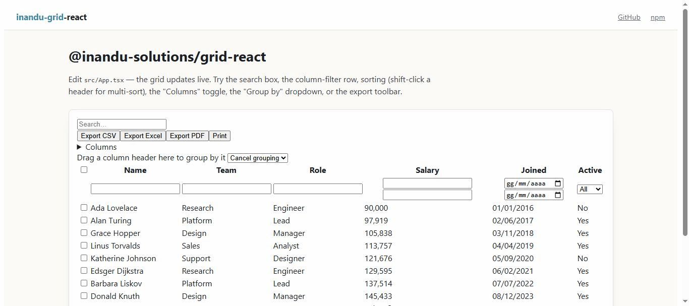
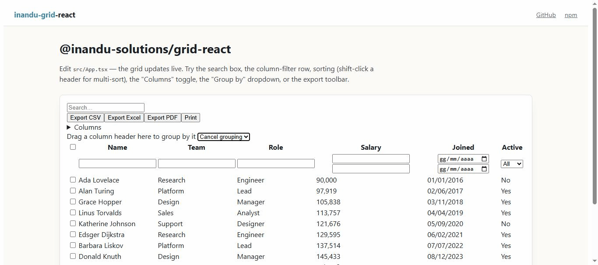

# inandu-grid-react

**A lightweight React data grid with the essentials other grids gate behind a paid enterprise
licence — row grouping, aggregates, inline editing and Excel-compatible export — fully MIT.** The
React port of [`@inandu-solutions/grid-angular`](https://github.com/inandusolutions/inandu-grid),
on the same framework-agnostic core
([`@inandu-solutions/grid-core`](https://github.com/inandusolutions/inandu-grid-core)) as its Angular and
Vue siblings: one core, three interfaces
([how it fits together](https://inandusolutions.github.io/inandu-grid-react/architecture.html)).

<p align="center"></p>

[](https://www.npmjs.com/package/@inandu-solutions/grid-react)
[](https://www.npmjs.com/package/@inandu-solutions/grid-react)
[](https://github.com/inandusolutions/inandu-grid-react/actions/workflows/ci.yml)
[](https://bundlephobia.com/package/@inandu-solutions/grid-react)
[](LICENSE)

[](https://inandusolutions.github.io/inandu-grid-react/)
[](https://stackblitz.com/github/inandusolutions/inandu-grid-react/tree/main/examples/stackblitz)

[](https://inandusolutions.github.io/inandu-grid-react/)

<sub>Live free-text search on the demo grid. [Try every feature →](https://inandusolutions.github.io/inandu-grid-react/)</sub>

## Try it in 30 seconds

```bash
npm install @inandu-solutions/grid-react
```

```tsx
import { InanduGrid } from '@inandu-solutions/grid-react';
import '@inandu-solutions/grid-react/style.css';

const rows = [{ name: 'Ada', age: 36 }, { name: 'Alan', age: 41 }];
const columns = [{ field: 'name', headerText: 'Name' }, { field: 'age', headerText: 'Age', type: 'number' as const }];

export default function App() {
  return <InanduGrid rows={rows} columns={columns} pageSize={25} />; // sorting + filtering are on by default
}
```

- **▶️ [Live demo](https://inandusolutions.github.io/inandu-grid-react/)** — try every feature in the browser.
- **⚡ [Edit in StackBlitz](https://stackblitz.com/github/inandusolutions/inandu-grid-react/tree/main/examples/stackblitz)** —
  installs `@inandu-solutions/grid-react` from npm; edit `src/App.tsx` and it updates live ([source](examples/stackblitz)).
- **📦 [`@inandu-solutions/grid-react` on npm](https://www.npmjs.com/package/@inandu-solutions/grid-react)**
  (MIT) — `0.x` while the API settles; expect breaking changes between minors until `1.0.0`.

## Who is this for?

- **CRUD / business apps** that need sortable, filterable, editable tables without pulling in a
  full enterprise grid framework.
- **Admin dashboards** that need grouping, aggregates and CSV/Excel/PDF export out of the box.
- **Data-heavy React apps** that need virtual scroll, or server-side sort / filter / paging
  against a backend (see [Server-side data](#server-side-data)), without the bundle size of a
  kitchen-sink grid.

**When not to use it:** if you need pivot tables or integrated charting built into the grid itself,
this isn't that — see [Not included](#not-included) below.

## Angular and Vue versions

[`inandu-grid`](https://github.com/inandusolutions/inandu-grid) is the original, reference implementation,
MIT-licensed Angular grid this repo is ported from — same core logic, a [broader feature set](https://github.com/inandusolutions/inandu-grid/blob/main/docs/feature-matrix.md), adapted for
Angular signals/standalone components instead of React hooks.
[`inandu-grid-vue`](https://github.com/inandusolutions/inandu-grid-vue) is the Vue 3 port
(`@inandu-solutions/grid-vue`) — same core, adapted for Vue's composition API.

## Not included

Deliberately *not* a kitchen sink: no pivoting and no integrated charts — those stay out of scope
so the core stays small and auditable. Everything else on this page (grouping, aggregates, editing,
export, virtual scroll, paged server-side mode) is included, free, no enterprise tier. If you need pivot
tables or built-in charts, a heavier framework is the right tool; if you want a focused, free,
lightweight grid, this is it.

## Commercial add-ons

`@inandu-solutions/grid-pro-react` *(private, paid, not released yet)* — the React port of
`@inandu-solutions/grid-pro`, depends on this package the same way grid-pro depends on grid-angular.

## See it

Grouping and live free-text search — running in the [demo](https://inandusolutions.github.io/inandu-grid-react/),
which also has tabs for inline editing and tree data.

[](https://inandusolutions.github.io/inandu-grid-react/)

## Features

**Covers the core feature set of grid-angular; a few Angular-only features are not ported (see the [feature matrix](https://github.com/inandusolutions/inandu-grid/blob/main/docs/feature-matrix.md)).** The framework-agnostic core (sorting, filtering,
aggregation, export, i18n) is the
[`@inandu-solutions/grid-core`](https://github.com/inandusolutions/inandu-grid-core) package, shared with
grid-angular and grid-vue. The React-specific layer — the
[`<InanduGrid>`](#api-shape) component and the [`useInanduGrid()`](#api-shape) headless hook —
covers:

- Sorting — single-column, or multi-column via shift-click
- Free-text search and per-column filtering, plus an `extraRowFilter` escape hatch for your own predicates
- Pagination, single-column grouping with aggregates, row selection
- CSV / Excel (`.xls`) / PDF export, and print
- i18n — 5 built-in languages via a `lang` prop
- Inline row editing, creation and deletion, with validation (required / min / max / pattern / custom / async)
- Excel-style Ctrl+C / Ctrl+V clipboard copy/paste
- Runtime column show/hide, sticky (pinned left/right) columns, drag-reorder
- Column resize (drag a header's handle) and autosize (double-click it to fit content)
- Row drag-reorder
- Tree data (`treeChildrenKey`) — display and expand only, no inline editing/drag/clipboard on tree
  rows, same restriction as grid-angular
- Master-detail (`renderDetail`)
- Custom cell / header / edit-control rendering per column (`renderCell` / `renderHeader` /
  `renderEditor`) — drop in your own component in place of the built-in formatted text, header
  label, or edit-mode input, without losing sorting, resizing, or validation. Note: the editor's `value` is always the raw control shape (text), so keep array/object cell values as delimited strings (or read `row[field]`) - see `InanduEditRenderContext`.
- Excel-style cell range selection (`cellRangeSelection`, `multiRange`) — click-and-drag or
  shift-click across cells to select a rectangular block; `Ctrl+C` copies the whole range as TSV
  when `clipboard` is also on
- Row virtualization (`virtualScroll`) for large datasets
- Server-side sort / search / filter / paging (`serverSide` + `useInanduGridServer`) — paged only;
  grid-angular's server-side infinite scroll isn't ported. See [Server-side data](#server-side-data)

Two things work slightly differently from grid-angular because they need a real browser layout
engine that a unit-test environment can't provide: virtual scroll's row height isn't
auto-measured — pass `virtualRowHeight` explicitly — and autosize's content measurement itself is
trusted (ported verbatim, same DOM APIs) rather than end-to-end tested; see
[`measureColumn.ts`](src/utils/measureColumn.ts)'s doc comment for exactly what its test suite does
and doesn't cover.

### Known limitation: virtual scroll has a fixed row height

`virtualScroll` assumes every row is exactly `virtualRowHeight` pixels tall (default 40). The scrollbar length and the position of the
window are computed from that number, so a row that is taller (wrapped text, a custom cell that grows) makes the scroll position drift
against the rows. Keep cells to one line, or set `virtualRowHeight` to the real height. Variable row height is not supported and is
not currently scheduled; if you need it, open an issue describing the case.

Virtual scroll replaces pagination, and it does not combine with grouping (grouping a virtual grid turns virtualization off), master/detail,
the row drag handle, the totals row or cell range selection.

For keyboard behaviour on a virtual grid, and the manual accessibility checklist, see [`ACCESSIBILITY.md`](ACCESSIBILITY.md).

## API shape

```tsx
import { InanduGrid, useInanduGrid } from '@inandu-solutions/grid-react';
import '@inandu-solutions/grid-react/style.css'; // optional default styling — skip it and bring your own

// Component: batteries-included table.
<InanduGrid rows={rows} columns={columns} />;

// Hook: headless — bring your own markup.
const { visibleRows, filteredRowCount, sortCriteria, setSort, filterValues, setFilterValue, page, setPage, pageCount } =
  useInanduGrid({ rows, columns, pageSize: 25 });
```

### Notifications

`onSelectionChange`, `onSortChange`, `onFilterChange`, `onPageChange` and the cell-range callbacks report what the user does. None
of them fires when the grid mounts (not even for the empty selection it starts with), nor when the state saved under `stateKey` is
put back, and a new inline arrow function on every render does not make them fire again. A server-side grid still gets that
restored query once, through `onQueryChange`.

### Your own delete confirmation

`deleteConfirmMessage` and `bulkDeleteConfirmMessage` ask with the browser's `window.confirm()`. To show your own dialog, pass
`confirmDelete`: a function that gets the row (or every selected row, for the bulk delete) and answers `true`, or a promise of
`true`, to go ahead. It replaces both messages. A rejection or a throw counts as not confirmed, and a second click while the
dialog is open is ignored.

```tsx
<InanduGrid rows={rows} columns={columns} deletable confirmDelete={rows => myDialog.ask(`Delete ${rows.length}?`)} />
```

### Saved state and server rendering

With `stateKey`, the grid saves column widths, order, visibility, pins, sort and filters to `localStorage` and puts them back the
next time: while it renders for the first time, so that draw already has them. A page that is being hydrated draws the defaults
first (as the server did) and restores right after. To avoid that jump on a server-rendered page, pass `initialState` with what the
server knows (same shape the grid saves: `{ sortCriteria, filterQuery, columnFilters, columnWidths, hiddenFields, ... }`); it is used
on the server and the client alike.

## Server-side data

For tables too big to load whole, let the backend sort, filter and page, and keep the grid's UI
unchanged:

```tsx
import { InanduGrid, useInanduGridServer } from '@inandu-solutions/grid-react';

const server = useInanduGridServer({ url: '/api/products' });

<InanduGrid
  rows={server.rows}
  columns={columns}
  pageSize={25}
  serverSide={{ totalItems: server.total }}
  onQueryChange={server.setQuery}
/>;
```

`useInanduGridServer` turns the grid's page / sort / search / column filters into a query string
(`?page=2&pageSize=25&sort=-price&q=cable&price_gte=20`), aborts superseded requests, debounces typing,
and keeps the previous page on screen while the next loads. It expects `{ data: [...], total: n }`; a reply of another shape
sets `error` (and keeps the rows on screen) instead of showing an empty grid, and a missing `total` is taken to be the number of rows
received. If your API answers differently, adapt it with `mapResponse`, e.g.
`useInanduGridServer({ url, mapResponse: b => ({ data: b.items, total: b.count }) })`.
That is exactly what [`Inandu.Grid.Extensions`](https://github.com/inandusolutions/inandu-grid-extensions)
(.NET / EF Core) returns from one `ToInanduGrid()` call — [request contract](https://github.com/inandusolutions/inandu-grid-extensions/blob/main/docs/request-contract.md) —
but any backend that speaks the same params works. Runnable example: [`examples/server-side`](examples/server-side).

In `serverSide` mode grouping, tree data, virtual scroll, `extraRowFilter` and column aggregate
totals are off (they would only ever see one page), and a column's Excel-style value checklist lists
the values on the current page. Use `buildInanduGridQuery(query)` if you'd rather do the fetching
yourself, and `fetcher` / `init` on the hook for auth headers or a custom client.

### Row identity (`rowId`)

Selection, tree expansion and master-detail expansion are remembered **by a key**, not by the row object,
so they survive a page change, a `reload()` and a parent that passes a derived array (`rows={data.filter(...)}`).
By default the key is the row's `id` field when it has one; otherwise the row object itself (the previous
behaviour). Point it somewhere else with `rowId`:

```tsx
<InanduGrid rows={rows} columns={columns} rowId="sku" />
<InanduGrid rows={rows} columns={columns} rowId={row => `${row.orderId}-${row.line}`} />
```

The key is also the React `key` of each row, so edit state follows a row through sorting, filtering and
drag-reorder. Give rows a unique key: duplicate ids are your data's problem and React will warn about them.

## Development

```bash
npm install
npm run dev        # Vite dev server
npm test           # Vitest + React Testing Library
npm run build      # library build (dist/)
```

## Contributing

Issues and PRs welcome. Please read [`CONTRIBUTING.md`](CONTRIBUTING.md) first, and note the
[Code of Conduct](.github/CODE_OF_CONDUCT.md). Security reports: [`.github/SECURITY.md`](.github/SECURITY.md).

## License

MIT © [Inandu SAS](https://www.inandu.com/)
